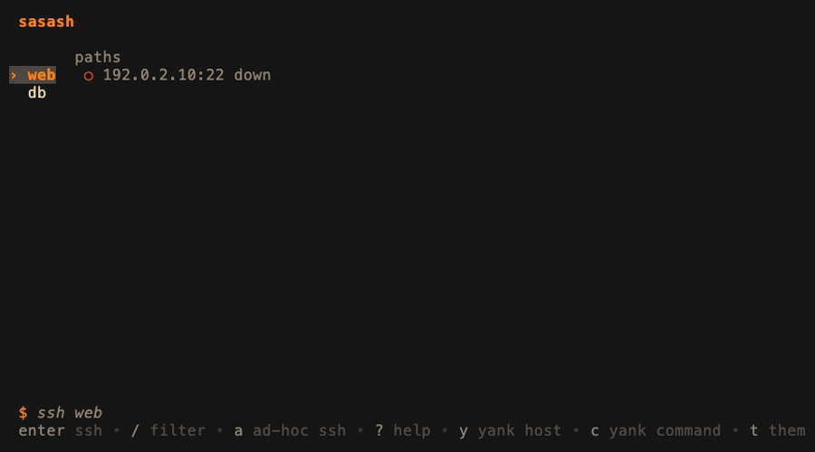

# sasash

A terminal UI over your `ssh_config`: browse hosts, see which network path is alive
**right now**, connect in one keypress, manage port-forwards, and copy files — all as a
*view* over the config you already have.

**Principle: sasash never does anything you could not see or do yourself.** It is a view
over `ssh_config` and OpenSSH control sockets — not an SSH implementation, not a daemon,
not a second place your connection info lives. It builds `ssh`/`scp` argv and execs; that
is all. See [`SPEC.md`](SPEC.md) for the design of record.



## What it does

- **Live path status** — the bit that bites daily: for each host it TCP-connects to every
  candidate address and shows which one is reachable now (`●` up · `○` down · `◌` pending),
  with latency. Nothing is inferred from Wi-Fi, gateway, or VPN interfaces — only a real
  connect is trusted.
- **One-keypress connect** — `enter` execs `ssh <host>`, handing your terminal to a normal
  SSH session (it reads your `ssh_config`, `ssh-agent`, `ProxyJump`, and `ControlMaster`,
  because it *is* `/usr/bin/ssh`).
- **Path switching** — when a host has several addresses (LAN / VPN / tailscale…), `p` picks
  which one is active; sasash rewrites a single managed connections file so every downstream tool
  (`ssh`, `scp`, `git`, VS Code Remote…) follows.
- **Port-forwards that persist** — declare a forward set once; `space` brings a forward up or
  down (one detached `ssh -N -L` process per port), `s` toggles the whole set. State is read
  from reality — a live process plus a local port dial — never a cache.
- **File transfer** — `C` copies files and directories between your machine and a host with
  `scp`, browsing **both ends** in the same browser (local over the filesystem, remote over
  `ssh … ls`). `space` marks several — the marks survive moving between directories — and one
  `scp` carries them all, reusing the host's active path and open ControlMaster so there's no
  re-auth.
- **Your settings, one file** — theme, editor, dotfiles in the browser, where `enter` spawns:
  `~/.config/sasash/config.toml`, created by `setup` with every option commented out, written
  back one line at a time by the keys that offer a choice. See
  [docs/configuration.md](docs/configuration.md).
- **Address as data** — `y` yanks the bare address to the clipboard (via the terminal's own
  OSC 52 escape, with `pbcopy`/`wl-copy`/`xclip`/`clip.exe` behind it); `c` yanks the exact
  command it would run.

Everything is keyboard-driven with vim motions (`j`/`k`, `g`/`G`, `ctrl+d`/`ctrl+u`, `/` to
filter). Press `?` for the full key list; the footer shows what the current surface does.

## Install

Prebuilt binaries for macOS and Linux (amd64 and arm64) ship with every
[release](https://github.com/nadavushka-dev/sasash/releases). Onboarding a machine is two
commands, no Go toolchain needed:

```sh
curl -fsSL https://raw.githubusercontent.com/nadavushka-dev/sasash/main/install.sh | sh
sasash setup
```

The installer picks the asset for your OS and architecture, verifies its sha256 against the
release's `checksums.txt`, installs to `~/.local/bin` (falling back to `/usr/local/bin` with
sudo), prints a PATH hint if that directory is not on your PATH, and offers to run
`sasash setup` — the one-time bootstrap that adds a single confirmed `Include` line to
`~/.ssh/config` and creates `config.toml`. `SASASH_VERSION=v0.3.1` pins a release;
`sh install.sh --help` lists the other knobs.

Already installed? `sasash update` moves the binary to the latest release in place — the
same asset and sha256 check, after asking (`sasash update --check` only reports).

From source instead (Go 1.26.4+):
`go install github.com/nadavushka-dev/sasash/cmd/sasash@latest`.

`sasash version` prints the release tag the binary was built from, and `sasash update` moves
an installed binary to the latest release in place — it downloads the same asset the installer
would, verifies it against `checksums.txt`, and swaps the file atomically after asking.
Binaries are not signed or notarized yet; a curl|sh download never carries the macOS
quarantine bit.

## Usage

Run `sasash` (or `sasash tui`) to open the browser. First run, `sasash setup` writes exactly
one connections file — `~/.ssh/config.d/sasash.conf`, an `ssh_config` fragment — and adds a single confirmed `Include`
line to `~/.ssh/config`. sasash edits only that one file, atomically, and re-reads before
every write, so your hand-edits always win.

Its own settings — `theme`, `editor`, `show_hidden` (dotfiles in the copy browser),
`spawn_target` and `spawn_window` — live in `~/.config/sasash/config.toml`, which `setup`
also creates with every option commented out. Upgrading from a release before 0.3.0? `setup`
moves the older theme, spawn-target and spawn-window files into it. Every key is documented
in [docs/configuration.md](docs/configuration.md).

### Keys

| | |
|---|---|
| **Navigate** | `j`/`k` move · `g`/`G` first/last · `ctrl+d`/`ctrl+u` half-page · `/` filter · `l`/`h` switch panes |
| **On a host** | `enter` ssh · `S` ssh here (handoff) · `H` herdr session beside · `p` pick path · `C` copy files (scp; `space` marks several) · `y` yank address · `c` yank command · `a` ad-hoc ssh · `R` rename · `e` edit connections |
| **Tunnels** (`l`) | `space` toggle a forward · `s` toggle the set · `+` add a forward · `n` declare a new set · `E` edit · `x` stop one · `X` delete the set · `r` restart master |
| **Copying** (`C`) | `u`/`d` direction · `space` mark · `enter` pick the row, or copy the marks · `.` this directory · `l`/`h` into / out of a directory · `H` dotfiles (local) · `esc` back a step |
| **Elsewhere** | `.` show other `ssh_config` entries · `$` show the command line · `t` theme · `o` settings · `?` keys · `q` quit |

The `?` panel lists the actions; vim motion is left implicit. Dark themes only — gruvbox by
default, plus mocha, tokyonight, and nord (`t` cycles, `o` picks).

### Commands

Beyond the TUI, the same engine is scriptable:

| Command | Does |
|---|---|
| `sasash` / `sasash tui` | interactive host browser (the default) |
| `sasash addr <host>` | print the first alive address for a host |
| `sasash status` | one line per host: alias, active path, dead paths |
| `sasash up <host>` | bring a host's declared forward sets up (`ssh -N` per port) |
| `sasash down <host>` | kill every tunnel process of a host |
| `sasash setup` | one-time bootstrap (the `Include` line, `sasash.conf`, `~/.ssh/cm/`, `config.toml`) |
| `sasash update` | replace this binary with the latest release — same asset and sha256 check as the installer; asks first (`-y` skips, `--check` only reports, a tag pins) |
| `sasash version` | print the version |

## How it works

sasash **shells out to `/usr/bin/ssh`** — it never uses `golang.org/x/crypto/ssh`, which
ignores `ssh_config`, `ssh-agent`, `ProxyJump`, and `ControlMaster`, i.e. everything this
design rides on. It constructs argv and execs. There is **no background daemon**, no
auto-reconnect (a dead tunnel goes red; you press `r`), no `ProxyCommand` dialer, and **no
secret storage** — auth is `ssh-agent`'s job. sasash writes exactly one connections file plus the
one-time `Include` insertion, and its own `config.toml` one line at a time — all atomically,
re-read before every write.

Runs natively on macOS and Linux; on Windows, use it inside WSL — the Windows OpenSSH port
has no ControlMaster multiplexing, which is the engine everything here rides on. The `y` yank
goes through the terminal's own OSC 52 clipboard escape first, so it works over ssh in
terminals that support it (most modern ones; not GNOME Terminal or macOS Terminal, and tmux
swallows it unless `set-clipboard` and the terminal's `Ms` capability let it through), with
`pbcopy`/`wl-copy`/`xclip`/`clip.exe` behind it, and it says which one took the text.

## Development

`make check` runs vet, race, and coverage; `make build` builds the binary; `gofmt -l .` must
be clean. The demo drives the real binary against the fixture config in `demo/home` (RFC 5737
documentation addresses, so every path shows as down). Regenerate it with `make demo`
(requires [vhs](https://github.com/charmbracelet/vhs): `brew install vhs`; the target skips
gracefully without it). A re-render can differ by a frame from timing jitter even with no
content change, so only commit the regenerated `demo/demo.gif` when the demo content actually
changed.

Dependencies are capped at `bubbletea`, `bubbles`, and `lipgloss`. See [`SPEC.md`](SPEC.md)
for the full design — the source of truth, the exact ssh argv, the milestones, and the
testing rules.
